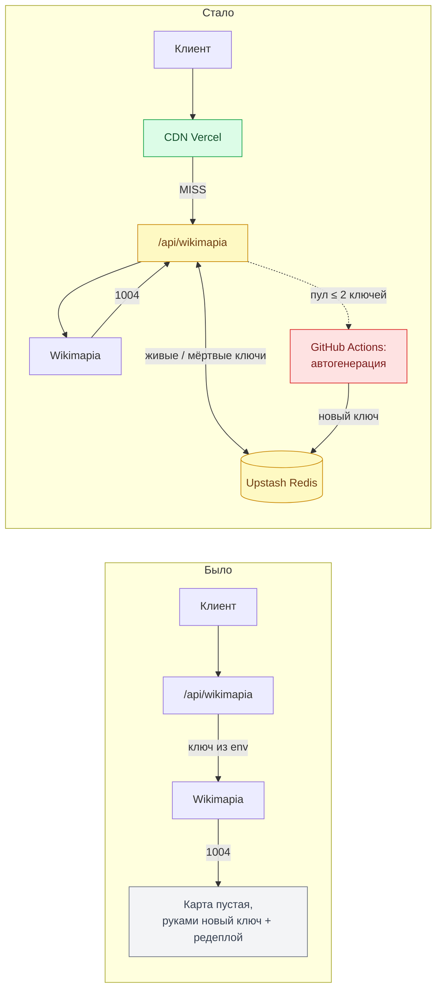

# 🔑 Автоматизация ключей Wikimapia API

> **📌 Кратко**
>
> Бесплатный ключ Wikimapia сгорает навсегда за 2–3 сеанса, и сейчас его приходится руками генерировать, вписывать в env Vercel и редеплоить. План: сначала снизить расход квоты (CDN-кэш — ✅ сделано), затем перенести ключи в Upstash Redis с пулом и ротацией по ошибке `1004`, а в конце — автогенерация новых ключей воркером в GitHub Actions.

## 🔍 Исходные данные

- Ключ создаётся только под залогиненным аккаунтом (`wikimapia.org/api/?action=create_key`). Капчи нет, ограничений на число ключей на аккаунт не замечено.
- Документация обещает сброс лимита через 24 часа, **по факту ключ после `1004` не оживает**.
- Ошибка приходит с HTTP 200 в теле: `{ "debug": { "code": 1004, "message": "…" } }`.
- Сейчас ключ один, лежит в env (`WIKIMAPIA_API_KEY`) → смена ключа = редеплой.
- API разрешено для некоммерческого использования; автоматическое создание ключей — серая зона ToS, риск бана служебного аккаунта принят.

## 🔄 Было → стало



Легенда: 🟩 сделано · 🟨 шаги 1–3 · 🟥 шаги 4–6 · ⬜ текущая проблема.

## 🧭 Рассмотренные варианты

| Вариант | Сложность | Убирает ручную работу | Риск | Решение |
|:-|:-:|:-:|:-:|:-:|
| CDN-кэш ответов | 🟢 | частично | ⚪ | ✅ сделано |
| Ключи в Redis + админ-эндпоинт | 🟢 | убирает редеплой | ⚪ | ✅ берём |
| Пул + ротация по `1004` | 🟡 | почти (пока есть запас) | ⚪ | ✅ берём |
| Автогенерация ключей | 🔴 | полностью | 🔴 ToS / бан / хрупкость | ✅ берём последним |
| Пользователь вводит свой ключ | 🟡 | нет | 🟡 | ❌ |

## ✅ Сделано: CDN-кэш (`bbb4005`)

- `api/wikimapia.ts` ставит `Cache-Control: public, s-maxage=86400, stale-while-revalidate=604800` на успешные ответы. Ответы с `debug`, не-200 и не-JSON — `no-store`.
- `normalizeBbox` расширяет bbox наружу до сетки 0.01°, и в запрос уходит нормализованный bbox: URL стабилен, CDN попадает в кэш.

> **📝 Заметка**
>
> Пустой ответ `[]` тоже кэшируется на сутки. Если всплывут «ложно пустые» области — дать `[]` короткий TTL.

## 🗄 Хранилище и ротация (шаги 1–3)

Структура в Redis:

```text
wikimapia:keys:alive   LIST   ключи в порядке использования (текущий — первый)
wikimapia:keys:dead    SET    сгоревшие ключи (навсегда, без TTL)
```

Логика прокси:

```ts
// псевдокод api/wikimapia.ts
for (const key of await getAliveKeys()) {
  const body = await fetchUpstream(params, key);
  if (debugCode(body) !== 1004) return respond(body);
  await markDead(key);             // LREM alive + SADD dead
  if (await aliveCount() <= 2) triggerKeyGeneration(); // шаг 5
}
return quotaExhausted();          // все ключи мертвы → клиент блокирует загрузки, как сейчас
```

Админ-эндпоинт для ручного пополнения:

```bash
curl -X POST https://<домен>/api/admin/keys \
  -H "Authorization: Bearer $ADMIN_SECRET" \
  -d '{"key":"XXXXXXXX-…"}'
```

`WIKIMAPIA_API_KEY` в env остаётся запасным вариантом на случай, если Redis не настроен (локальная разработка без Upstash).

## 🤖 Автогенерация (шаги 4–6)

- **Разведка:** создать ключ руками с открытым DevTools → Network, сохранить HAR (логин → форма create_key → страница «My keys»). По нему решаем: хватит ли `fetch` с cookie-сессией или нужен Playwright.
- **Воркер:** GitHub Actions workflow — логин служебным аккаунтом, создание ключа, парсинг ключа со страницы, `RPUSH` в Redis. Секреты: логин/пароль Wikimapia, URL/токен Upstash.
- **Триггеры:** cron (раз в сутки — держать запас) + `repository_dispatch` от прокси, когда живых ключей ≤ 2.
- **Уведомление:** если воркер упал — сообщение в Telegram, чтобы сломанный парсер не остался незамеченным.

> **⚠️ Риск**
>
> Вёрстка wikimapia.org может поменяться — парсер сломается молча. Поэтому шаги 1–3 должны работать сами по себе: ручное пополнение через админ-эндпоинт остаётся запасным путём.

> **⛔ Риск**
>
> Бан служебного аккаунта. Использовать отдельный аккаунт, не основной; не генерировать ключи «про запас» сотнями — держать пул в 3–5 штук.

## 🗺 Порядок работ

| # | Шаг | Проверка |
|:-:|:-|:-|
| 0 | Деплой CDN-кэша, пара дней наблюдения | `x-vercel-cache: HIT` на повторных запросах; ключ живёт дольше 2–3 сеансов |
| 1 | Ключи в Upstash Redis, env — запасной вариант | Новый ключ подхватывается без редеплоя |
| 2 | Пул и ротация по `1004` в прокси | С мёртвым первым ключом карта грузится, ошибки в UI нет |
| 3 | `POST /api/admin/keys` с секретом | Ключ добавляется одним `curl` |
| 4 | HAR логина и create_key | Понятно: `fetch` или Playwright |
| 5 | GitHub Actions: автогенерация по cron и `repository_dispatch` | Пустой пул сам пополняется без участия человека |
| 6 | (опц.) Уведомление в Telegram о падении воркера | Сломанный воркер виден сразу |

## ❓ Решить до старта

- [ ] Создать Upstash Redis через Vercel Marketplace (Storage → Upstash Redis); скопировать `KV_REST_API_URL` / `KV_REST_API_TOKEN` в локальный `.env`.
- [ ] Придумать `ADMIN_SECRET` и добавить в env Vercel.
- [ ] Завести отдельный служебный аккаунт Wikimapia (к шагу 4).
- [ ] Снять HAR создания ключа (к шагу 4).
